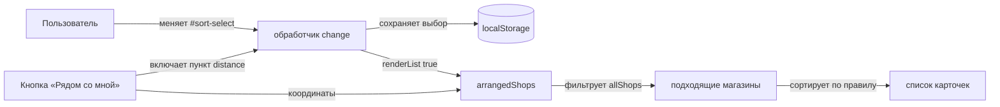

# Design

## Context

Список магазинов рендерится на клиенте из накопленного набора `allShops`
(`internal/web/static/js/app.js`). Сейчас порядок зависит от данных: при
включённой геолокации — по расстоянию, иначе — в порядке ответа MCP. Явного
управления сортировкой нет.

## Goals / Non-Goals

**Goals:**

- Дать пользователю выбрать порядок: по расстоянию, по рейтингу, по адресу.
- Сохранять выбранный порядок при обновлении данных и смене фильтров.

**Non-Goals:**

- Не менять серверный API и формат точек.
- Не добавлять сортировку на карту: маркеры кластеризуются независимо.

## Decisions

**D1. Сортировка выполняется на клиенте.**
Источник данных — общий `allShops`, сервер отдаёт точки без гарантии порядка.
Альтернатива — параметр `sort` на сервере: потребовал бы менять контракт
`/api/shops/points` и кэш, хотя список всё равно собирается в браузере.

**D2. Отдельный select в панели фильтров.**
Значения: `distance`, `rating`, `address`. Выбор хранится в `localStorage`,
чтобы переживать перезагрузку. Альтернатива — сортировка по клику на заголовок
списка: в текущей вёрстке заголовка нет.

**D3. Значение `distance` доступно только при известных координатах.**
Без геолокации пункт недоступен (disabled) и список падает на `address`.

## Взаимодействие

Шаги: пользователь меняет значение в `#sort-select`; обработчик `change`
сохраняет выбор в `localStorage` и вызывает `renderList(true)`; `arrangedShops`
фильтрует `allShops` и сортирует результат по выбранному правилу; после нажатия
«Рядом со мной» координаты появляются, и `distance` становится доступным без
перезагрузки страницы.

## Risks / Trade-offs

- [Сортировка по рейтингу у магазинов без рейтинга] → такие магазины уходят в
  конец, порядок между ними — по адресу.
- [Рост числа карточек при сортировке] → сохраняем лимит `MAX_CARDS`.
