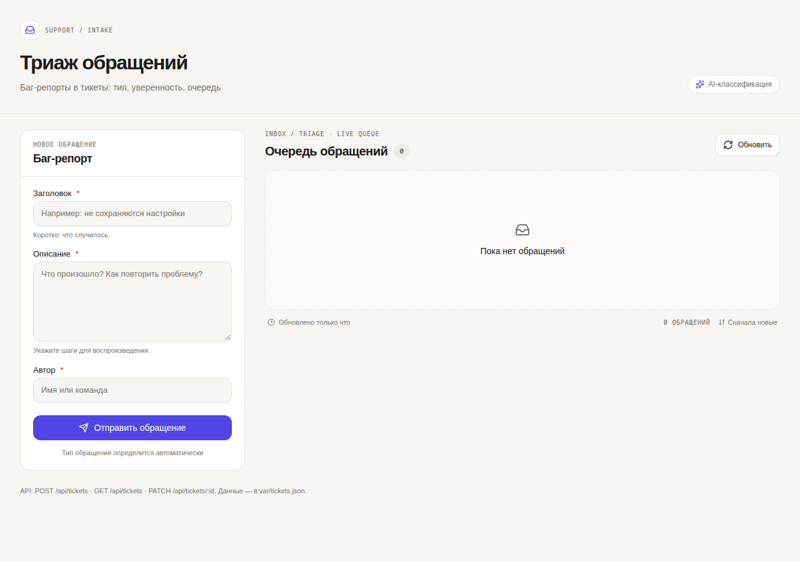
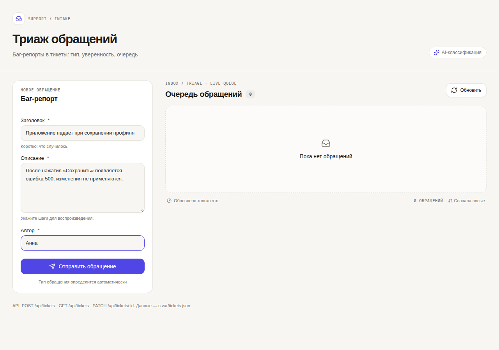
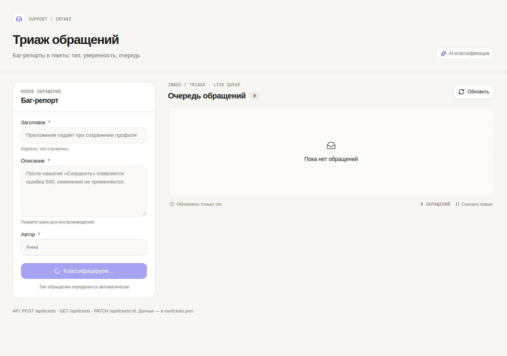
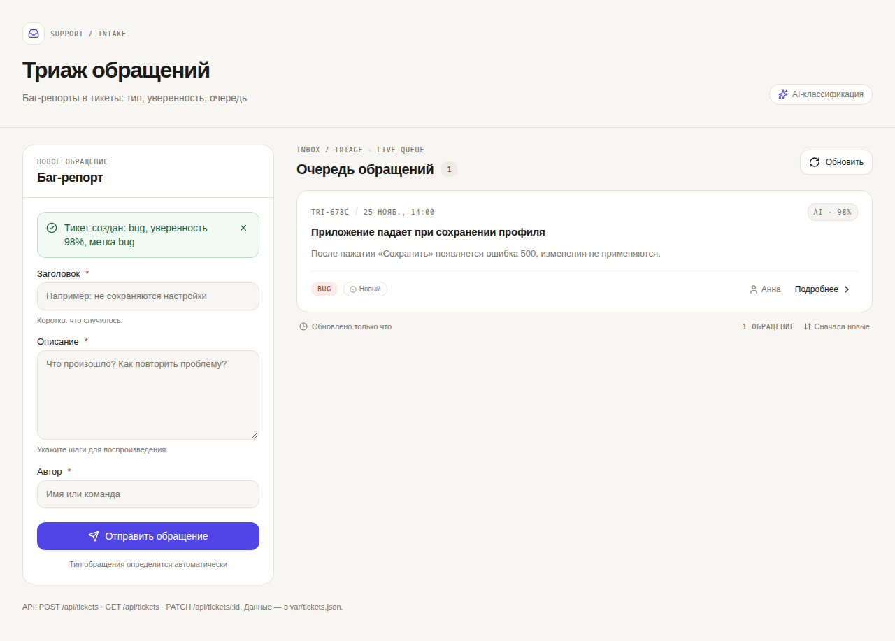
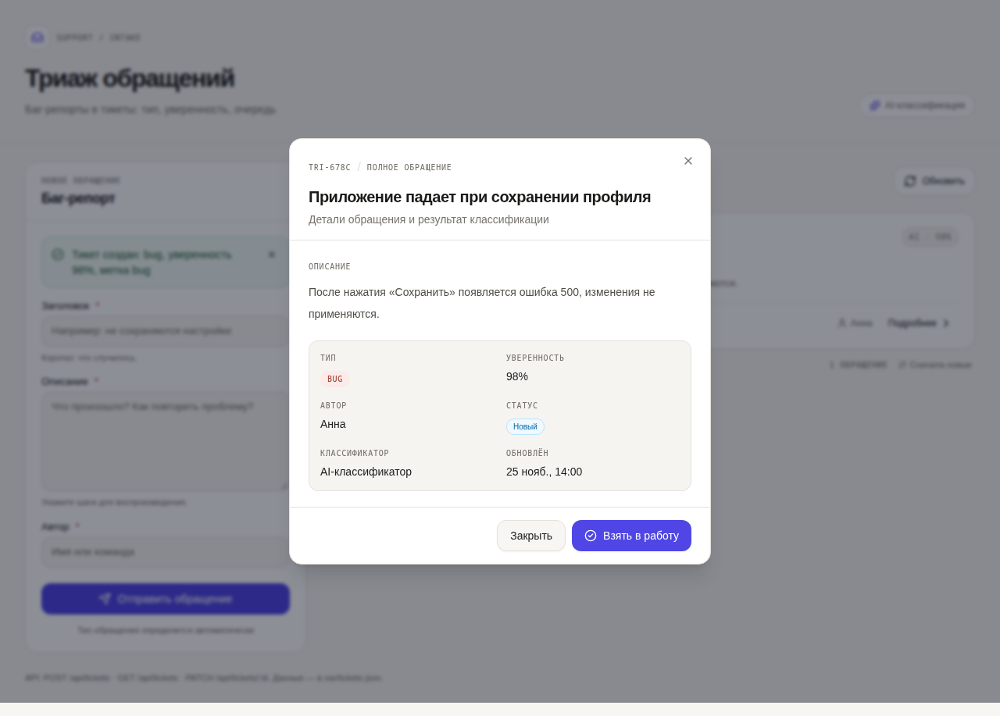
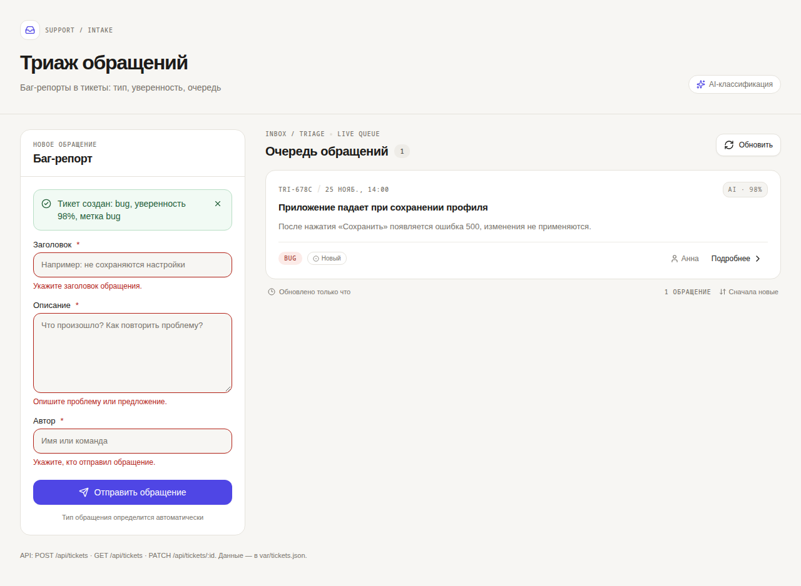
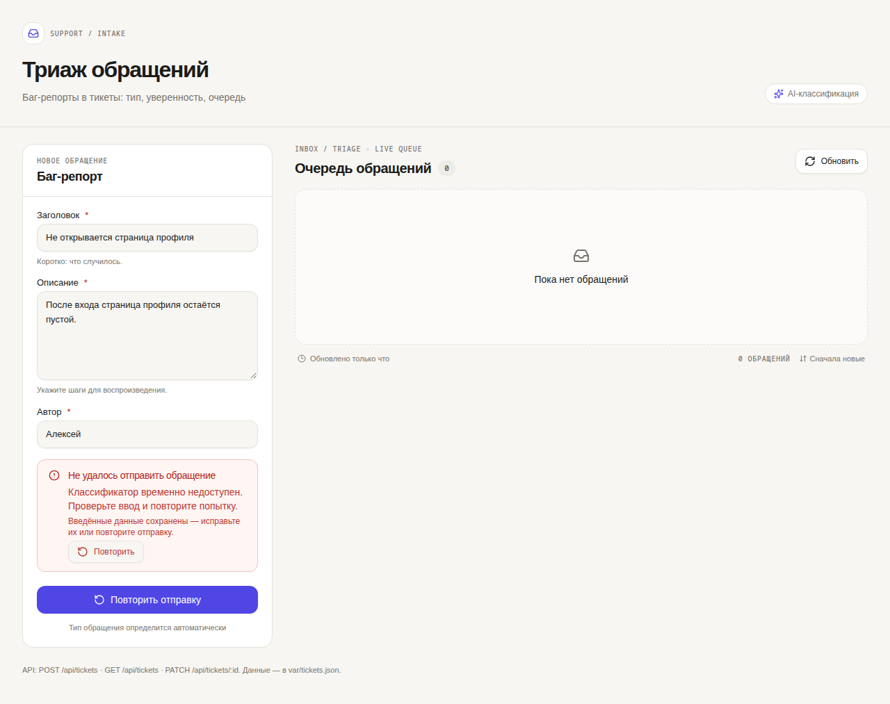
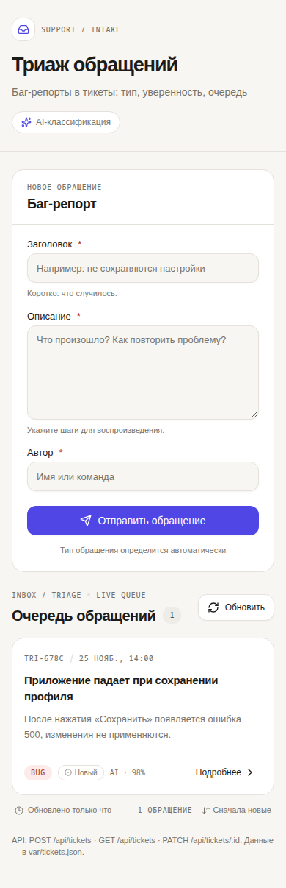
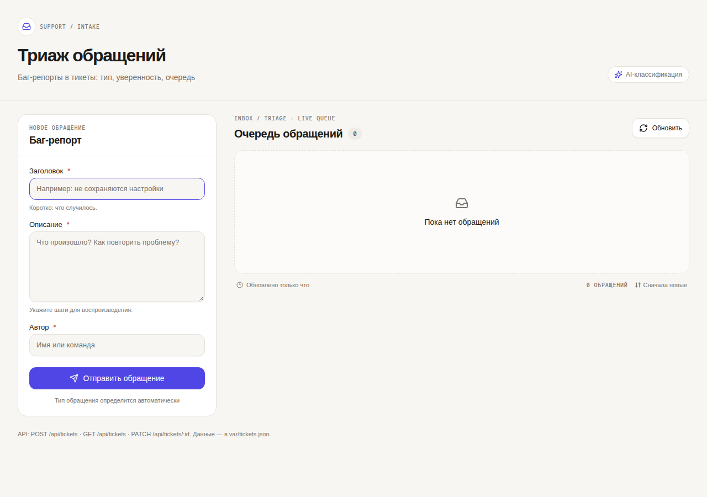

# Консоль триажа обращений

Фронтенд к ассистенту поддержки из практики 07.2. Агент заполняет баг-репорт, AI определяет
тип обращения и уверенность, тикет появляется в очереди. Детали открываются в диалоге,
оттуда тикет можно взять в работу.

**Стек:** Vite, React, TypeScript, Tailwind CSS, shadcn/ui.
**Тесты:** Vitest, React Testing Library, MSW.
**API:** Node.js без фреймворка, JSON-хранилище, классификатор на VseLLM или эвристике.

**Макет:** [v0-прототип](https://v0.app/chat/gIQDdcFAfGT) · [описание и промпты](mockups/README.md)

## Сценарий

1. Очередь пустая, видно «Пока нет обращений».
2. Пользователь заполняет «Заголовок», «Описание», «Автор».
3. Нажимает «Отправить обращение». Пока идёт запрос, кнопка показывает «Классифицируем…»,
   поля disabled.
4. AI возвращает тип (`bug`, `task`, `feature`) и уверенность. При уверенности ниже 0.8
   тикет уходит в `needs-triage`.
5. Карточка встаёт первой в очереди, форма очищается, появляется сообщение об успехе.
6. «Подробнее» открывает диалог. «Взять в работу» меняет статус через `PATCH`.

## Быстрый запуск

```bash
cd practices/practice_08/solution
npm install
npm run dev
```

Приложение: http://localhost:5173
API: http://127.0.0.1:8787/api/health

```bash
npm test         # 25 клиентских тестов
npm run build    # typecheck + сборка
npm start        # API + статика из dist на 8787
```

Если установлен `make`, те же команды короче (из папки `solution`):

```bash
make setup   # npm install + .env из примера
make dev     # Vite + API
make stop    # остановить dev
make status  # проверить API и Vite
make check   # тесты и сборка
make e2e-headed  # интеграционные тесты в браузере
make help    # все цели
```

Если `make dev` пишет `EADDRINUSE`, значит порт 5173 или 8787 уже занят:

```bash
make status
make stop
```

`make stop` убивает только dev-сервер этого проекта: сначала по `var/dev.pid`, затем по
командной строке с проверкой рабочей директории. Чужие Vite и node не трогает.

Из корня репозитория: `make -C practices/practice_08/solution help`.

## Настройки

Скопируйте `.env.example` в `.env`. Файл `.env` в git не попадает.

| Переменная | Назначение |
|---|---|
| `CLASSIFIER` | `heuristic` (по умолчанию), `llm` или `n8n` |
| `VSELLM_API_KEY` | ключ VseLLM для режима `llm` |
| `VSELLM_BASE_URL` | `https://litellm.data-light.ru/v1` |
| `VSELLM_MODEL` | `openai/gpt-5.2` |
| `N8N_WEBHOOK_URL` | webhook для режима `n8n`; принимает `{title, body}`, возвращает `{type, confidence}` |
| `API_DELAY_MS` | задержка API, чтобы состояние загрузки было видно |
| `SIMULATE_ERROR` | `1` — API отвечает 503, для показа ошибки |
| `DATA_FILE` | путь к JSON-хранилищу, по умолчанию `var/tickets.json` |

Без ключа приложение работает на эвристике: тесты и сценарий проходят, сеть не нужна.
С ключом VseLLM классификация идёт через `openai/gpt-5.2`; при ошибке LLM автоматически
включается эвристика (`classifier: heuristic-fallback`).

## API

| Метод | Путь | Что делает |
|---|---|---|
| `GET` | `/api/tickets` | список, новые первыми |
| `POST` | `/api/tickets` | валидация, классификация, создание |
| `PATCH` | `/api/tickets/:id` | `in-progress` или `closed` |
| `GET` | `/api/health` | статус и режим классификатора |

Формат ошибок: `{ error: { code, message, fields? } }`. Валидация — `422`,
недоступный классификатор — `503`. Подробный контракт — в [spec.md](spec.md).

## Интерфейс

| Состояние | Скриншот |
|---|---|
| Исходное |  |
| Ввод |  |
| Загрузка |  |
| Результат |  |
| Диалог |  |
| Валидация |  |
| Ошибка |  |
| Узкий экран |  |
| Видимый фокус |  |

Макет и те же состояния прототипа: [mockups/README.md](mockups/README.md).

## Дизайн-система

- **shadcn/ui** — `src/components/ui`: Button, Input, Textarea, Label, Card, Badge, Alert,
  Dialog, Skeleton. Готовые компоненты, не самописные кнопки.
- **Тема** — `src/index.css`: цвета, шрифты, радиусы и отступы в CSS-переменных и `@theme`.
  Компоненты используют токены (`bg-card`, `text-muted-foreground`, `border-border`), не hex.
- **Типографика** — Inter для интерфейса, IBM Plex Mono для меток `mono-label`
  (uppercase, tracking 0.08em).
- **Палитра** — тёплый фон `#F7F6F3`, графит `#1C1B19`, индиго `#4F46E5` для главного
  действия и фокуса.

## Тесты

Все клиентские тесты проходят:

```text
Test Files  4 passed (4)
Tests       25 passed (25)
```

| Файл | Что проверяет |
|---|---|
| `src/features/tickets/TicketForm.test.tsx` | подписи, обязательные поля, минимальная длина, фокус на ошибке, обход полей с клавиатуры, очистка ошибки при вводе, блокировка полей, повторная отправка, ошибка сервера и сохранение текста |
| `src/features/tickets/TicketList.test.tsx` | загрузка, пустое состояние, ошибка загрузки и повтор, карточка, открытие деталей |
| `src/features/tickets/TicketDetailsDialog.test.tsx` | данные тикета, смена статуса, закрытие кнопкой и Escape, закрытый тикет, ошибка действия, блокировка на время сохранения |
| `src/App.test.tsx` | полный сценарий до видимого результата, загрузка списка, ошибка загрузки и повтор, ошибка отправки и повтор, защита от второго запроса, диалог и смена статуса |

Ответы сервера замоканы в `src/test/handlers.ts` через MSW: пустой список, создание,
`PATCH`, задержка и ошибки. `onUnhandledFrame: 'error'` роняет тест на незамоканном запросе.

## Интеграционные тесты в браузере

`e2e/` — Playwright Test: реальный Chromium, реальный фронтенд и API. Это не демо-скрипт,
а тесты с проверками: если поведение сломается, прогон упадёт.

```bash
make e2e-headed   # видимый браузер, slowMo 400 мс
make e2e          # headless, для CI
make e2e-debug    # Playwright Inspector, пошагово
make e2e-report   # HTML-отчёт последнего прогона
```

Что покрыто:

- полный сценарий с настоящим API и VseLLM: форма → классификация → тикет → диалог → «В работе»;
- валидация пустой формы;
- ошибка загрузки списка и повтор;
- ошибка отправки, сохранение ввода и повтор;
- повторная отправка во время ожидания: три submit → один POST.

Перед каждым тестом `e2e/reset.ts` очищает `var/tickets.json`. На падении Playwright
сохраняет скриншот, видео и trace в `test-results/`. Первый запуск требует браузера:
`npx playwright install chromium`.

## Соответствие критериям

| # | Критерий | Где смотреть |
|---|---|---|
| 1 | Макет через AI, доступен, все состояния | [v0-прототип](https://v0.app/chat/gIQDdcFAfGT), `mockups/screens/`, промпты в `mockups/README.md` |
| 2 | Библиотека компонентов, переиспользование | `src/components/ui`, README выше |
| 3 | Единые цвета, типографика, отступы | `src/index.css`, токены в компонентах |
| 4 | Полный сценарий с реальным API | `server/api.mjs`, скриншоты 01–05, `npm run dev` |
| 5 | Интерфейс соответствует макету | сравнить `docs/screens/` и `mockups/screens/` |
| 6 | Подписи, клавиатура, видимый фокус | `Label`, `aria-*`, `focus-visible` в `src/components/ui` |
| 7 | Повторная отправка не создаёт второй запрос | `TicketForm.test.tsx`, `App.test.tsx` («во время ожидания…») |
| 8 | Тесты компонентов и взаимодействий | `TicketList.test.tsx`, `TicketDetailsDialog.test.tsx` |
| 9 | Тесты валидации | `TicketForm.test.tsx` (пустая форма, короткие значения) |
| 10 | Состояния с замоканными ответами | `App.test.tsx`, `src/test/handlers.ts` |
| 11 | Один тест проходит сценарий целиком | `App.test.tsx` → «от пустого списка до созданного тикета» |

## Использование AI

- **v0** — прототип и визуальное направление. Полный промпт и правки — в `mockups/README.md`.
- **VseLLM `openai/gpt-5.2`** — классификатор в `server/api.mjs`. Промпт возвращает строго
  `{type, confidence}`; при ошибке — эвристика.
- **OpenCode + скиллы с skills.sh** — `frontend-design`, `web-design-guidelines`,
  `webapp-testing`, `verification-before-completion`; для русского текста — `slopotron`.
- **MCP** — `context7` для документации, `playwright` для браузера; конфиг в корневом
  `opencode.json`.

Примеры запросов:

- Макет: «Собери прототип консоли триажа с формой, очередью, диалогом и панелью из пяти
  состояний; тёплый фон, индиго-акцент, моноширинные метки, без градиентов».
- Интерфейс: «Реализуй сценарий по `spec.md`. Сначала назови компоненты из `src/components/ui`,
  которые переиспользуешь. Цвета и отступы — только из токенов `src/index.css`.»
- Тесты: «Покрой повторную отправку: пока POST висит, сделай три submit и проверь, что MSW
  получил ровно один запрос. Добавь тесты пустого списка, загрузки, ошибки и полного сценария.»

Что пришлось исправить после AI:

- тест на повторную отправку сначала проверял счётчик до того, как MSW получал запрос;
  переписал на ожидание состояния «Классифицируем…» и повторные submit во время него;
- в MSW 3 опция `onUnhandledRequest` переименована в `onUnhandledFrame`;
- после ошибки отправки оставался старый зелёный баннер успеха — теперь успех сбрасывается
  при новом submit и при вводе;
- TypeScript 7 удалил `baseUrl` — пути `@/*` переведены на относительные от `tsconfig.json`;
- в первой версии прототипа «Исходное» показывало примеры тикетов, а не пустое состояние;
  добавил follow-up в v0, чтобы исходный экран был пустым.

## Структура

```text
solution/
├── server/            API, классификатор, статика
├── src/
│   ├── api/           typed-клиент fetch
│   ├── components/ui/ shadcn/ui
│   ├── features/tickets/ форма, список, карточка, диалог
│   └── test/          MSW, фикстуры, setup
├── mockups/           v0-экспорт, скриншоты прототипа, промпты
├── docs/screens/      скриншоты рабочего интерфейса
├── e2e/               Playwright: интеграционные тесты
├── scripts/           запуск dev с проверкой портов
├── spec.md            поведение и контракт API
└── .env.example       настройки без секретов
```
